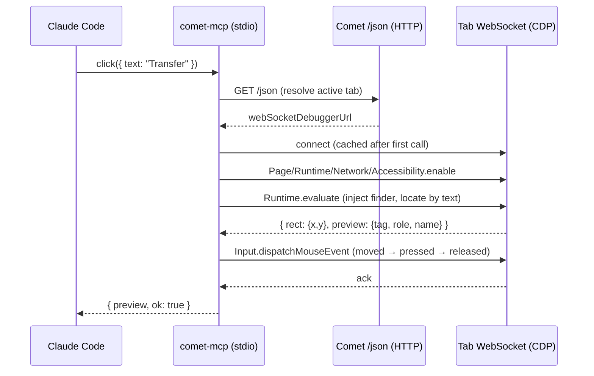

# Design Notes

This server treats Comet as Chrome with a CDP endpoint. Discovery uses `http://127.0.0.1:9224/json` for page tabs and `Target.createTarget` on the browser websocket for new tabs. Page work uses tab-level `webSocketDebuggerUrl` connections.

The main deliberate choice is raw CDP plus cached tab sessions. A tab connection enables `Page`, `Runtime`, `Network`, and `Accessibility` once, then stays open for later tools. That gives lower latency and lets `network_log` work as a rolling in-memory trace. The cache is still soft state: tab ids are refreshed from `/json`, and a missing or closed socket reconnects on the next call.

The Origin gotcha is handled by using Node's `ws` client without an Origin header. Python `websocket-client` commonly sends Origin and gets rejected by recent Chromium builds; Python `websockets` also works because it omits Origin, but Node made the MCP stdio server tighter.

Click and fill avoid storing DOM node handles between calls. Every action injects a tiny finder and re-resolves the target immediately before the mouse or input event. That is important for React dashboards where prior elements may be stale after a render. CSS selectors are supported, but the intended dashboard workflow is usually text or role+name. Ambiguous matches are errors with previews.

Screenshots default to inline MCP image content because Claude and other clients can render them directly. The server also supports `out_path` for full-page screenshots or repeated capture loops where base64 would make stdio noisy.

The server does not auto-launch Comet. The whole point is using the user's logged-in browser, and auto-launching can pick the wrong profile or hide the fact that an existing Comet process lacks the debug port. Instead, browser-unreachable errors include the exact launch command and, on Windows, try to detect a running `comet.exe` without the debug flag.

## Flow diagram

## Known limitations

- `active` in `list_tabs` means active within this MCP process, not necessarily the frontmost Comet tab before the server started.
- `network_log` only includes events after this server attaches to a tab.
- Role+name click matching is accessibility-like DOM logic, while `accessibility_tree` is the real Chrome AX tree. If a specific dashboard exposes unusual AX-only nodes, use `accessibility_tree` to inspect and then fall back to nearby text/CSS.
- Cookie values are redacted by default. Pass `include_values: true` only when you really need them.
